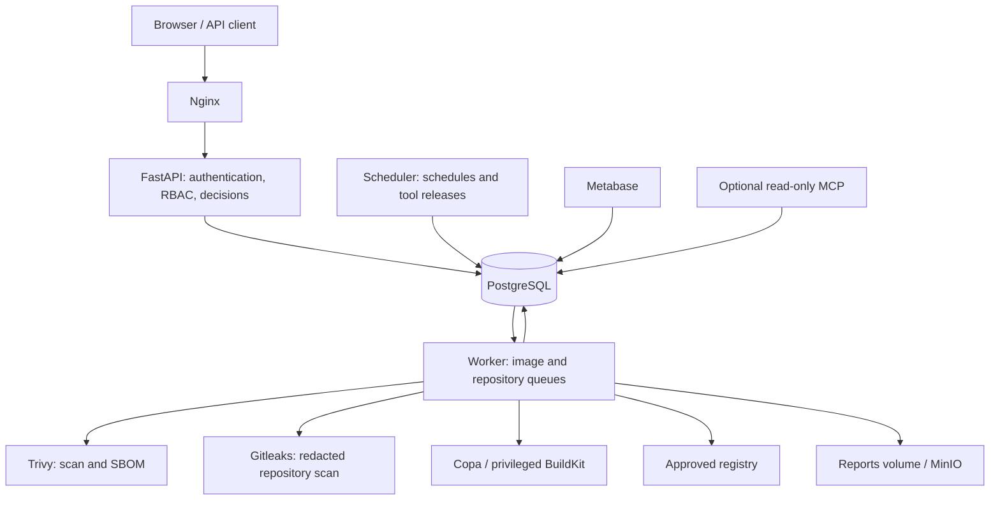

# Architecture — v2

AppSec separates authorization, execution, evidence and analytics.

| Component | Role / boundary |
| --- | --- |
| Nginx / FastAPI | Local browser, REST, scoped resources; no Docker socket |
| PostgreSQL | Durable jobs, workflow state, decisions, findings, credentials ciphertext, audit and tool metadata |
| Worker | Claims image/security jobs; Docker socket; local image and artifact operations |
| BuildKit | Privileged local patch executor; source policy is not a firewall |
| Scheduler | Recurring image scans, credential expiry, release discovery/install; Docker socket for scanner updates |
| Reports / MinIO | Raw evidence and generated HTML/SARIF; authenticated access or scoped presigned URLs |
| Metabase | Independent login and global analytics; use restricted SQL role |
| MCP | Optional globally scoped bounded read-only analytics; no execution |

Normal startup uses a combined worker (image before security); production Compose also defines dedicated image/security workers, not a validated multi-host pool. A stalled job can delay subsequent jobs. Scanner stages have configurable timeouts; process interruption recovery and robust distributed leases are open work.

The manual path creates verified initial evidence, awaits approval, prepares a local image, rescans, produces a comparison and an advisory recommendation, then awaits separate publication or keep-local decision. No initial policy gate. CI has an independent explicit severity gate.

Runtime images are selected by approved source priority. The verified local Docker image ID and remote manifest digest are different identities. Publication pulls the resulting digest and compares its local config ID with the verified patched image. Tags alone do not establish immutable content.

Release updates are scheduler-owned; Copa uses a shared versioned volume, while scanners use selected version tags via approved sources. Tool release changes and database refresh are separate. Source fingerprints detect stale API/worker/scheduler deployments.

## Trust assumptions

Use a dedicated host; Docker socket effectively grants host-level control. Registry and package-manager egress, redirects, image signing/pinning, external SSO, tenant-scoped BI/MCP, HA and DR require additional deployment controls. Prepared images are local to one daemon; multi-host publication needs affinity or trusted staging. See [security review](security-review.md).

## v3 development: shared first-party runtime image

API, Worker, Scheduler, dedicated image/security workers and migration CLI use one locally built image (`appsec-docker-runtime:local` by default). Only appsec-runner owns the build configuration; each role keeps its own entrypoint, privileges, mounts and lifecycle. Startup builds once, migrates, then recreates changed services without redundant builds. This reduces duplicate image tags/builds, not persistent container count. Docker layer deduplication already existed; do not assume a proportional disk saving. The separate MCP image, Nginx, PostgreSQL, BuildKit, MinIO and Metabase remain. Go migration is deferred.
