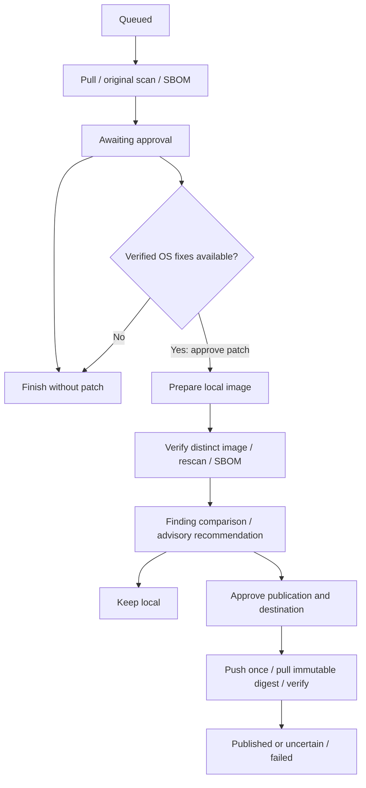

# Image workflow — state and approvals

Full platform startup enables patching. Each guided request still starts as an original scan without registry writes or patch execution.

Original scans cover OS and application vulnerabilities including unfixed entries. Missing/invalid OS inventory or changed image identity fails visibly. Only OS findings with FixedVersion are eligible for automated package remediation. No known OS fix is not a scan failure; finish without patch. Application dependencies require their own rebuild/remediation.

The first approval is local patch preparation only. The prepared image must have a different Docker image ID and a verified second scan. Post-patch policy is **Recommended / Not recommended**, not an automatic publication blocker. For not-recommended images a risk reason of at least ten characters is required. The second approval names a complete authorized destination; with APPSEC_REQUIRE_SECOND_APPROVER=true it must come from another authorized reviewer. Worker rechecks authorization and identity before push. A failed or uncertain push requires manual reconciliation; never blindly retry.

| State | Meaning |
| --- | --- |
| queued / scanning | Initial execution; queued scan can be canceled |
| awaiting_approval | Original result saved; review and finish or approve patch |
| patch_queued / patch_running / patch_failed | Local preparation and verification |
| awaiting_publication / publication_blocked | Final review; legacy blocked states may remain |
| publish_queued / publishing / publish_failed | Separate registry operation |
| completed / completed_without_publish / published / canceled / failed | Terminal outcome |

API actions: finish, cancel, approve_patch (confirm_patch=true), skip_publish, approve_publish (confirm_push=true, destination, risk_reason when required). Backend serializes decisions and rechecks role/project scope. Approvals persist identities and timestamps.

CLI run IMAGE is report-only with respect to policy, run IMAGE --patch prepares/rescans locally, and ci image explicitly enforces CI thresholds independently. No CLI run automatically publishes. See [CI](ci-policy-guide.md).

Idle pipelines with completed/failed execution can be exported or deleted by an admin even if awaiting approval; queued/running jobs cannot be bulk-selected. Deletion discards pending decisions, not remote images or audit logs.

## Preselected execution route and stop

On Image scan, choose Guided, Scan only, Scan & patch, or Scan, patch & optimize. Auto patch explicitly authorizes local Copa only and rechecks user/project access before enqueueing. Admin-only optimization mode preselects optional nginx modules and prepares a digest-bound plan after Copa, or after original scan if no eligible patch exists. It never automatically removes packages or publishes. Package repository priority lives in Settings > Registries > Package repositories; it is used for APT, not Trivy DB. Advanced diagnostics are collapsed in workflow details. Stop workflow cancels queued jobs and pending plans, prevents new stages and retries and waits for the current tool operation to finish at a safe boundary. A running registry push cannot be rolled back or safely canceled by this control. Local outputs/evidence remain. Stopping requires workflow write access. This release uses migration 0022; back up before upgrading.
