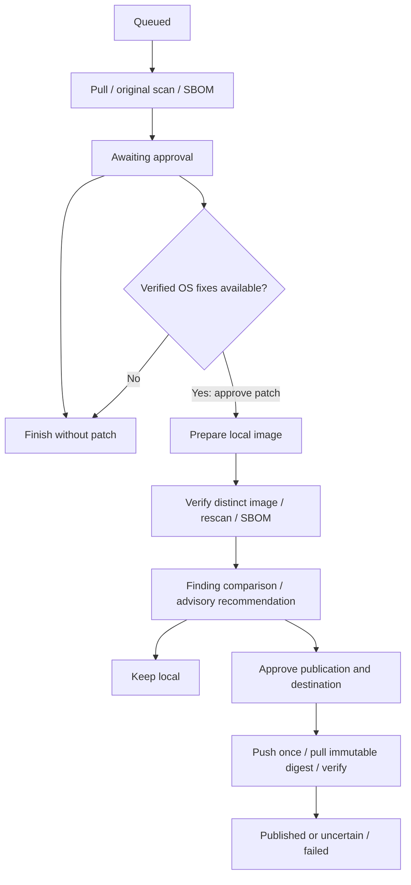

# Image workflow — state and approvals

Full platform startup enables patching. Each guided request still starts as an original scan without registry writes or patch execution.

Original scans cover OS and application vulnerabilities including unfixed entries. Missing/invalid OS inventory or changed image identity fails visibly. Only OS findings with FixedVersion are eligible for automated package remediation. No known OS fix is not a scan failure; finish without patch. Application dependencies require their own rebuild/remediation.

The first approval is local patch preparation only. The prepared image must have a different Docker image ID and a verified second scan. Post-patch policy is **Recommended / Not recommended**, not an automatic publication blocker. For not-recommended images a risk reason of at least ten characters is required. The second approval names a complete authorized destination; with APPSEC_REQUIRE_SECOND_APPROVER=true it must come from another authorized reviewer. Worker rechecks authorization and identity before push. A failed or uncertain push requires manual reconciliation; never blindly retry.

| State | Meaning |
| --- | --- |
| queued / scanning | Initial execution; queued scan can be canceled |
| awaiting_approval | Original result saved; review and finish or approve patch |
| patch_queued / patch_running / patch_failed | Local preparation and verification |
| awaiting_publication / publication_blocked | Final review; legacy blocked states may remain |
| publish_queued / publishing / publish_failed | Separate registry operation |
| completed / completed_without_publish / published / canceled / failed | Terminal outcome |

API actions: finish, cancel, approve_patch (confirm_patch=true), skip_publish, approve_publish (confirm_push=true, destination, risk_reason when required). Backend serializes decisions and rechecks role/project scope. Approvals persist identities and timestamps.

CLI run IMAGE is report-only with respect to policy, run IMAGE --patch prepares/rescans locally, and ci image explicitly enforces CI thresholds independently. No CLI run automatically publishes. See [CI](ci-policy-guide.md).

Idle pipelines with completed/failed execution can be exported or deleted by an admin even if awaiting approval; queued/running jobs cannot be bulk-selected. Deletion discards pending decisions, not remote images or audit logs.

## Preselected execution route and stop

On Image scan, choose Guided, Scan only, Scan & patch, or Scan, patch & optimize. Auto patch explicitly authorizes local Copa only and rechecks user/project access before enqueueing. Admin-only optimization mode preselects optional nginx modules and prepares a digest-bound plan after Copa, or after original scan if no eligible patch exists. It never automatically removes packages or publishes. Package repository priority lives in Settings > Registries > Package repositories; it is used for APT, not Trivy DB. Advanced diagnostics are collapsed in workflow details. Stop workflow cancels queued jobs and pending plans, prevents new stages and retries and waits for the current tool operation to finish at a safe boundary. A running registry push cannot be rolled back or safely canceled by this control. Local outputs/evidence remain. Stopping requires workflow write access. This release uses migration 0022; back up before upgrading.

Live Watch now refreshes workflow details on state transitions instead of repeatedly loading full reports. Advanced optimization details load only when opened; active or preselected optimization is shown near the next action. A managed Trivy container can be interrupted on a stop request and only its named container is cleaned up. BuildKit/Copa and other atomic operations still stop at a safe boundary. Exhausted Trivy DB source lists fail once rather than re-running every source for automatic job retries. Known Docker Hub mirrors use the documented aquasec DB namespace; this does not prove mirror availability. No stale cache fallback added.

## Unattended local UI routes

New UI workflows persist `unattended=true` before enqueue. Scan-only finishes automatically. Scan & patch applies verified eligible fixes locally (or finishes with original findings if none) and retains the result. Scan, patch & optimize pre-authorizes only selected optional nginx modules and their validated dependency closure; the existing APT protections, exact plan digest, re-simulation and frozen-DB scans remain. The exact automatic task is approved transactionally, then the workflow finishes locally. Second-approver policy prevents unattended optimization; revocation, unsafe plans and tool failures end visibly instead of asking for decisions. Older workflows and API callers without `unattended` retain their existing approval semantics. A normal Copa patch may instead use a preselected complete registry destination. The registry must permit Push in the project, second-approver policy must be disabled, and final recommendation must be recommended/passed. If any gate fails, no push is performed; the workflow reports a failure and retains available local evidence. Optimized candidates remain local and are not automatically published or certified functionally compatible. Existing separately authorized publication is unchanged.

## Optimized candidate reporting

The workflow distinguishes the Copa stage from the optimization candidate. If no OS finding has a known fixed version, targeted Copa is skipped with an explicit log and eligibility count. The main report reads the automatic candidate by its persisted task ID and displays the original-to-final frozen-DB counts, including LOW. New candidates retain complete frozen scan evidence in the optimization result; historical candidates retain aggregate evidence only. This does not authorize publication or prove functional compatibility. No change to Copa patch strategy is made by this reporting fix.

## Automatic comprehensive fallback and fresh databases

New unattended patch routes use targeted Copa if the original verified report has known OS fixes; otherwise they queue comprehensive Copa (no report flag). Legacy guided and direct targeted CLI behavior is unchanged. An unavailable patch or unchanged output is not a successful fix. Debian 12/13 linux/amd64 images can use the ordered Package repositories setting: AppSec probes signed repositories, prepares a unique local image with only default Debian repository URLs replaced, and uses Copa's Docker-local BuildKit endpoint (requires compatible Docker/containerd image store). The original image is never modified; package inventory, lineage and runtime configuration are checked. No fallback on trust errors. Other distributions use their original package repositories. Set TUNA first in Settings > Registries > Package repositories for restricted Debian access. The vulnerability DB metadata must be within NextUpdate; stale or malformed data invalidates only the metadata marker and tries the next approved OCI source. Java metadata is checked when prefetch is enabled. All stale/unavailable sources fail the scan. This release does not compare two independently generated Copa candidates or add application patching; the existing optimized-candidate frozen comparison remains unchanged. Test runtime behavior on the target Docker daemon before production.

Copa 0.14.1 additionally updates APT and installs busybox-static in its Debian tooling image before touching the target. The approved tooling image is therefore prepared using the same selected mirror and local source-policy mapping. APT refresh errors are fatal in both prepared images. Copa's generated BaseImage label is explicitly distinguished from application labels. Local preparation images are temporary; previously Copa-patched inputs with BaseImage metadata require separate lineage review.

The workflow timeline and image results identify the recorded actual Copa strategy and chosen package mirror. New regression tests exercise the command argument selection, not just the eligibility helper.

### Restricted-network DB refresh (supersedes the strict NextUpdate-only rule)

Each OCI database download uses a separate temporary cache directory. A usable active database is never discarded merely because NextUpdate passed; only complete, supported-schema metadata and database files within the configured maximum age are eligible. Newer usable data is retained while trying subsequent sources. When all sources fail or are overdue, local scanning can continue with a visible warning for up to 72 hours of vulnerability DB age (168 hours Java, when prefetched). A six-hour refresh cooldown avoids repeated attempts during scan/SBOM/rescan. `APPSEC_TRIVY_DB_SOURCES` and `APPSEC_TRIVY_JAVA_DB_SOURCES` optionally override the derived mirror list with exact administrator-approved OCI repositories. Existing `.env` stays valid. Freshness evidence is saved with each scan; automatic registry publication requires fresh original and patched evidence. This is not a guarantee that all advisories are present. Run one image worker against this cache and do not run the legacy maintenance DB updater concurrently; it bypasses staging. Invalid/over-age data fails closed. No changes to Copa strategy in this patch.
